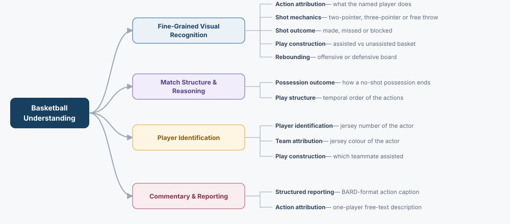
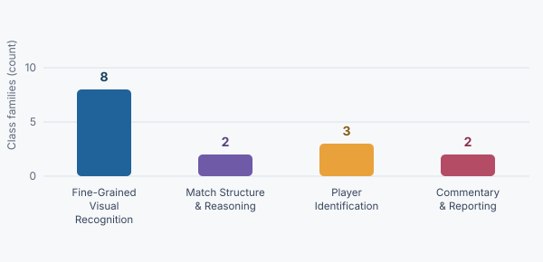

# BARD Categorical Evaluation

This document organizes basketball-understanding evaluation tasks supported by the [BARD](https://huggingface.co/datasets/GabrieleGiudici/BARD) clip annotations (the per-clip action lists in `dataset_paths.csv` and BARD's own `captions/caption.json`.

**Research alignment:** the four super categories correspond to common sports multimodal evaluation themes—fine-grained visual recognition, structural and temporal reasoning, identity grounding, and captioning/reporting—while their specific tasks remain constrained by the available annotations.

| Framework summary | Count |
|---|---:|
| Super categories | **4** |
| Fine categories | **12** |
| Class families | **15** |
| Templates | **16** (14 MCQ, 2 QA) |

## Category hierarchy

*The hierarchy groups each MCQ/QA class into exactly one fine category and one of four broad basketball-understanding capabilities.*

## Class families

*The graph shows the number of MCQ/QA class families assigned to each super category.*

## Fine-category glossary

<table>
  <thead>
    <tr><th>Super category</th><th>Fine category</th><th>Meaning</th><th>Example</th></tr>
  </thead>
  <tbody>
    <tr>
      <td rowspan="5"><strong>Fine-Grained Visual Recognition</strong></td>
      <td>Action Attribution</td>
      <td>Recognizing which of the nine logged action types a specific, visually addressed player performs.</td>
      <td>The player in the green number 34 jersey attempts a free throw.</td>
    </tr>
    <tr>
      <td>Shot Mechanics</td>
      <td>Classifying a shot attempt as a two-point shot, three-point shot, or free throw, at clip level or for a named shooter.</td>
      <td>The attempt from beyond the arc is a three point shot.</td>
    </tr>
    <tr>
      <td>Shot Outcome</td>
      <td>Determining whether a shot attempt scores, and whether a missed field goal is blocked.</td>
      <td>The lay-up rolls off the rim, and no defender blocks it.</td>
    </tr>
    <tr>
      <td>Play Construction</td>
      <td>Determining whether a made basket was assisted by a teammate.</td>
      <td>The corner three is assisted by a kick-out pass.</td>
    </tr>
    <tr>
      <td>Rebounding</td>
      <td>Deciding which team collects a missed shot.</td>
      <td>The defending team secures the defensive rebound.</td>
    </tr>
    <tr>
      <td rowspan="2"><strong>Match Structure &amp; Reasoning</strong></td>
      <td>Possession Outcome</td>
      <td>Recognizing how a possession without a shot attempt ends: a foul, a steal, or an unforced turnover.</td>
      <td>A defender steals the ball to force the turnover.</td>
    </tr>
    <tr>
      <td>Play Structure</td>
      <td>Ordering the distinct logged actions of a clip in time.</td>
      <td>The three point shot happens before the rebound.</td>
    </tr>
    <tr>
      <td rowspan="3"><strong>Player Identification</strong></td>
      <td>Player Identification</td>
      <td>Reading the jersey number of the player who performs the asked action, against same-team distractor numbers.</td>
      <td>The foul is committed by number 9 in red.</td>
    </tr>
    <tr>
      <td>Team Attribution</td>
      <td>Naming the jersey colour of the acting player, out of the two colours worn in that game.</td>
      <td>The turnover is committed by a white-jersey player.</td>
    </tr>
    <tr>
      <td>Play Construction</td>
      <td>Reading the jersey number of the teammate who assists a made basket.</td>
      <td>Number 10 delivers the assist on the number 27 basket.</td>
    </tr>
    <tr>
      <td rowspan="2"><strong>Commentary &amp; Reporting</strong></td>
      <td>Structured Reporting</td>
      <td>Producing BARD's caption format listing every action with jersey number, colour, action type, result, and assist.</td>
      <td>“A player with jersey number 5 and jersey_color white made a 2PT Shot which result was made …”</td>
    </tr>
    <tr>
      <td>Action Attribution</td>
      <td>Producing a one-sentence free-text description of what one addressed player does.</td>
      <td>The player wearing the black number 3 jersey commits a foul.</td>
    </tr>
  </tbody>
</table>

## Category summary

| Super category | Fine categories | Primary raw fields | Evaluation focus |
|---|---|---|---|
| Fine-Grained Visual Recognition | Action Attribution; Shot Mechanics; Shot Outcome; Play Construction; Rebounding | `action`, `result`, `assisted`, `color` (actors addressed by `color`+`player`) | Recognize per-player and per-clip visual events and their outcomes |
| Match Structure & Reasoning | Possession Outcome; Play Structure | Clip action sets; play-by-play list order | Reason over the composition and temporal order of a possession |
| Player Identification | Player Identification; Team Attribution; Play Construction | `player`, `color`, `other_player` | Localize the acting player and read identity off the jersey |
| Commentary & Reporting | Structured Reporting; Action Attribution | `captions/caption.json` verbatim; templated slot fields | Produce grounded structured or targeted free-text reports |

## 1. Fine-Grained Visual Recognition

<table>
  <thead><tr><th>Fine category</th><th>MCQ/QA class type</th><th>Format</th><th>Ground-truth field(s)</th><th>Example question</th></tr></thead>
  <tbody>
    <tr><td><strong>Action Attribution</strong></td><td><code>player_action</code></td><td>MCQ</td><td><code>action</code>; addressed by <code>color</code>+<code>player</code>, unique in clip</td><td>What does the player wearing the &lt;colour&gt; number &lt;n&gt; jersey do in this video?</td></tr>
    <tr><td rowspan="2"><strong>Shot Mechanics</strong></td><td><code>shot_type</code></td><td>MCQ</td><td><code>action</code> of the clip's shot slots</td><td>What type of shot attempt is shown in this video?</td></tr>
    <tr><td><code>shot_type_targeted</code></td><td>MCQ</td><td><code>action</code></td><td>What type of shot does the player wearing the &lt;colour&gt; number &lt;n&gt; jersey attempt in this video?</td></tr>
    <tr><td rowspan="3"><strong>Shot Outcome</strong></td><td><code>shot_result</code></td><td>MCQ</td><td><code>result</code></td><td>The video shows a single shot attempt. Does the shot go in?</td></tr>
    <tr><td><code>shot_result_targeted</code></td><td>MCQ</td><td><code>result</code></td><td>Does the shot taken by the player wearing the &lt;colour&gt; number &lt;n&gt; jersey go in?</td></tr>
    <tr><td><code>block_present</code></td><td>MCQ</td><td>any <code>action == Block</code> in the clip</td><td>The field goal attempt in this video is missed. Is the shot blocked by a defender?</td></tr>
    <tr><td><strong>Play Construction</strong></td><td><code>shot_assisted</code></td><td>MCQ</td><td><code>assisted</code></td><td>The field goal by the player wearing the &lt;colour&gt; number &lt;n&gt; jersey goes in. Was it assisted by a teammate?</td></tr>
    <tr><td><strong>Rebounding</strong></td><td><code>rebound_side</code></td><td>MCQ</td><td>rebounder <code>color</code> == shooter <code>color</code></td><td>A shot is missed and rebounded in this video. Which team gets the rebound?</td></tr>
  </tbody>
</table>

## 2. Match Structure & Reasoning

<table>
  <thead><tr><th>Fine category</th><th>MCQ/QA class type</th><th>Format</th><th>Ground-truth field(s)</th><th>Example question</th></tr></thead>
  <tbody>
    <tr><td><strong>Possession Outcome</strong></td><td><code>possession_loss</code></td><td>MCQ</td><td>exact action-set membership</td><td>No shot is attempted in this video. Which of the following happens?</td></tr>
    <tr><td><strong>Play Structure</strong></td><td><code>action_order</code></td><td>MCQ</td><td><code>action</code> of the first or last slot via play-by-play list order</td><td>Which of these actions happens FIRST in this video?</td></tr>
  </tbody>
</table>

`action_order` has FIRST and LAST templates (`action_order`, `action_order_last`). The last action is a rebound in 59.6% of clips, so report LAST separately and never merge it into FIRST.

## 3. Player Identification

Answers are per-instance (jersey numbers and per-game colours), so options are shuffled and chance is the effective floor for the number classes. Distractor numbers come from the same team in the same game, so colour cannot be used to eliminate options.

<table>
  <thead><tr><th>Fine category</th><th>MCQ/QA class type</th><th>Format</th><th>Ground-truth field(s)</th><th>Example question</th></tr></thead>
  <tbody>
    <tr><td><strong>Player Identification</strong></td><td><code>actor_jersey_number</code></td><td>MCQ</td><td><code>player</code>; distractors from same-colour game pools</td><td>Which &lt;colour&gt;-jersey player commits a foul in this video?</td></tr>
    <tr><td><strong>Team Attribution</strong></td><td><code>actor_team_colour</code></td><td>MCQ</td><td><code>color</code>; options are the game's two colours</td><td>What colour jersey is worn by the player who commits a turnover in this video?</td></tr>
    <tr><td><strong>Play Construction</strong></td><td><code>assister_jersey_number</code></td><td>MCQ</td><td><code>other_player</code></td><td>The basket scored by the player wearing the &lt;colour&gt; number &lt;n&gt; jersey was assisted. Which teammate made the assist?</td></tr>
  </tbody>
</table>

## 4. Commentary & Reporting

Both classes are open-ended and scored by the LLM judge. `clip_caption` keeps BARD's exact caption text for comparability with published BARD / BaCEF numbers; `player_action_description` gives the judge a short single-fact target, which it scores far more reliably than a multi-clause caption.

<table>
  <thead><tr><th>Fine category</th><th>MCQ/QA class type</th><th>Format</th><th>Ground-truth field(s)</th><th>Example question</th></tr></thead>
  <tbody>
    <tr><td><strong>Structured Reporting</strong></td><td><code>clip_caption</code></td><td>QA</td><td><code>captions/caption.json</code> verbatim</td><td>Analyze the basketball video and extract all player actions, using BARD's caption format.</td></tr>
    <tr><td><strong>Action Attribution</strong></td><td><code>player_action_description</code></td><td>QA</td><td>Templated over <code>color</code>, <code>player</code>, <code>action</code>, <code>result</code></td><td>Describe what the player wearing the &lt;colour&gt; number &lt;n&gt; jersey does in this video.</td></tr>
  </tbody>
</table>

## Data generation stages

The BARD categorical generator is [`generate_categorical_mcq_qa.py`](../generate_categorical_mcq_qa.py) in this example directory (`avlm/data_prep_example/basketball/`); [`prepare_training_data_pipeline.py`](../prepare_training_data_pipeline.py) runs it end-to-end (media probe → generate + split), the basketball counterpart of the tennis `--mode categorical` pipeline. Its inputs are the BARD tree's `dataset_paths.csv` and `captions/caption.json`, and the probed media table `clip_media.json` written by [`probe_clip_media.py`](../probe_clip_media.py) (all clips are 60 fps; the 128-frame cap binds on 100% of clips at `video_sample_fps: 60`). A clip is the sample: nothing is cut and `video_root` is the BARD tree itself.

Per split it emits (under `training_basketball_data_output/`, prefix `bard_cat`):

| File | Contents |
|---|---|
| `<prefix>_<split>.jsonl` | HF conversation rows + `id`, `class`, `evaluation_type`, `super_category`, `fine_category` |
| `<prefix>_<split>_meta_input.jsonl`, `<prefix>_<split>_meta_input_video_metadata.json` | One row per clip (`{id, video}`), plus the `{path: [duration, frames, fps]}` table that `avlm/utils/build_video_metadata.py` would produce, copied from the probed media table |
| `split_stats.json` | Per-split, per-class support, chance, majority, and duration-only baselines |

Row schema, option lettering, and one real example per class are specified in [`TEMPLATE_EXAMPLES_CATEGORICAL.MD`](TEMPLATE_EXAMPLES_CATEGORICAL.MD) (`class` is the question type; options are lettered `(A)`, `(B)`, … with no code suffix; answer distributions are allowed to be imbalanced).

## Data-quality gates

1. Exclude game `nyk-vs-mia-0022400869` from the nine colour- and identity-dependent classes: both teams are intermittently labelled `white`. Clip-level classes and `clip_caption` keep it.
2. Drop the 2 `assister_jersey_number` rows whose assister jersey is the corrupt string `'ko'`.
3. Apply each class's ambiguity filter so every row has exactly one correct answer, and record the exclusion counts in `split_stats.json`.
4. Shuffle options per row and verify answer letters are near-uniform per class.
5. Split by game, never by clip; every row derived from one clip stays in one split.
6. Report per-class support and imbalance before enabling a class; for the imbalanced `rebound_side` and `block_present`, report macro accuracy and a confusion matrix.
7. Report chance, majority, and the duration-only baseline from `split_stats.json` next to every model score.
8. Treat list order as temporal order only where corroborated; exclude the 27 clips whose rebound is logged before the shot from `rebound_side`.
9. Answer labels come only from `captions/caption.json` and the CSV fields, never from rosters, player names, or scorebug state.
10. Evaluate every class audio-on and audio-off: broadcast commentary states shot results, shot types, and player names, so the difference separates visual recognition from speech recognition.
11. Report results at all three levels: super category, fine category, and MCQ/QA class.
